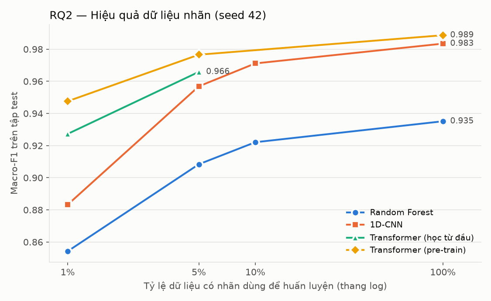
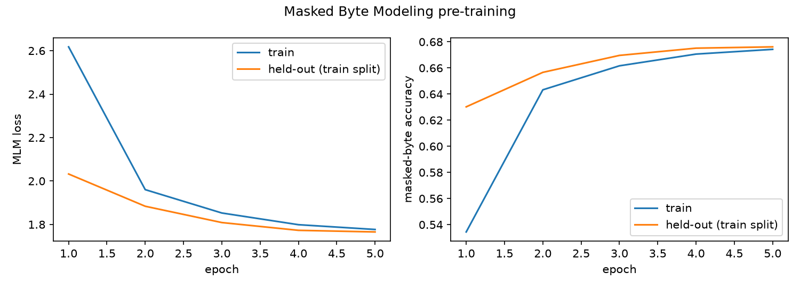
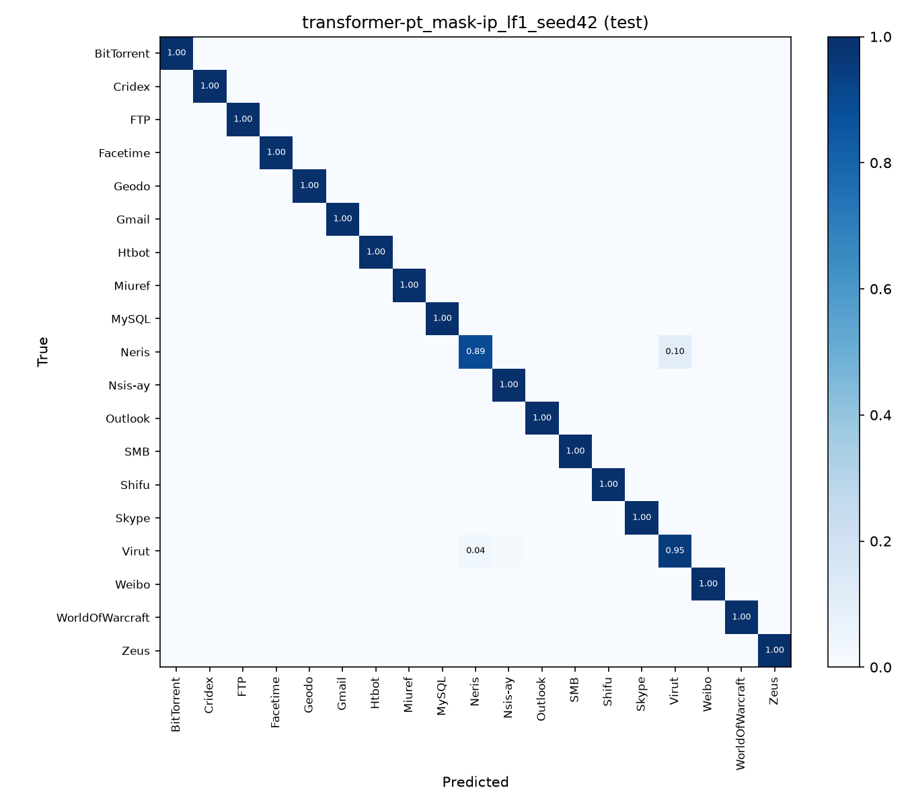

# Kết quả thực nghiệm — Phân loại lưu lượng mạng mã hóa

> File này được sinh tự động bởi `make report` (`src/etc/eval/report.py`) từ các file `results/*.json`. Mọi con số đều lấy từ kết quả chạy thật; mục nào chưa chạy ghi "chưa có kết quả". Quy ước số: dấu chấm là phần thập phân, dấu phẩy ngăn cách hàng nghìn.

## 1. Dữ liệu

- Bộ dữ liệu: **ustc-tfc2016**, 19 lớp, 83,930 session (train/val/test = 67,146 / 8,392 / 8,392).
- Lớp bị loại vì quá ít session: Tinba.
- Session trùng đã loại (hash byte biến thể `ip_port`): 1 (+0 trùng khác nhãn).
- Chia theo session, phân tầng 80/10/10, seed 42; mọi mô hình dùng chung `splits.json`.

## 2. RQ1 — So sánh các thế hệ (100% nhãn)

| Mô hình | Thế hệ | Seed | Accuracy | **Macro-F1** | Kích thước | Thời gian train | Độ trễ (batch 1) | Throughput (batch 256) |
|---|---|---|---|---|---|---|---|---|
| Random Forest | Học máy | 42 | 0.9301 | **0.9351** | 930,624 nút cây | 3.6 s | 7.56 ms | 24,840 mẫu/s |
| BiGRU | Học sâu | 42 | 0.7880 | **0.7916** | 402,707 tham số | 4.4 phút | 1.57 ms | 5,260 mẫu/s |
| 1D-CNN | Học sâu | 42 | 0.9864 | **0.9835** | 5,774,227 tham số | 5.3 phút | 0.73 ms | 2,521 mẫu/s |
| Transformer (pre-train) | Pre-training | 42 | 0.9912 | **0.9887** | 3,504,151 tham số | 41.7 phút fine-tune + 42.3 phút pre-train | 15.58 ms | 282 mẫu/s |

Ghi chú: giá trị là trung bình ± độ lệch chuẩn qua các seed (nếu có hơn một seed). Độ trễ và throughput đo trên **1 luồng CPU** sau warm-up; huấn luyện trên GPU Apple M2 (MPS). Kích thước của Random Forest là tổng số nút cây. Transformer fine-tune ở mọi seed dùng chung encoder pre-train seed 42.

## 3. RQ2 — Hiệu quả dữ liệu nhãn (seed 42)

| Mô hình | 1% nhãn | 5% nhãn | 10% nhãn | 100% nhãn |
|---|---|---|---|---|
| Random Forest | 0.8542 | 0.9084 | 0.9221 | 0.9351 |
| 1D-CNN | 0.8833 | 0.9569 | 0.9712 | 0.9835 |
| Transformer (học từ đầu) | 0.9273 | 0.9659 | chưa có kết quả | chưa có kết quả |
| Transformer (pre-train) | 0.9476 | 0.9766 | chưa có kết quả | 0.9887 |

Lợi ích riêng của pre-train (Transformer pre-train − Transformer học từ đầu, macro-F1): 1%: +0.0203; 5%: +0.0107.

## 4. RQ3 — Học tắt: che IP / port (100% nhãn, seed 42)

| Mô hình | Không che | Che IP (mặc định) | Che IP + port |
|---|---|---|---|
| 1D-CNN | chưa có kết quả | 0.9835 | chưa có kết quả |
| Transformer (pre-train) | chưa có kết quả | 0.9887 | chưa có kết quả |

Giá trị là macro-F1 trên tập test; số trong ngoặc là chênh lệch so với cấu hình mặc định (che IP). Nếu bỏ che mà điểm tăng mạnh, hoặc che port mà điểm giảm mạnh, mô hình đang dựa vào định danh mạng (IP/port) thay vì đặc điểm lưu lượng.

## 5. Pre-training (Masked Byte Modeling)

| Biến thể mask | Seed | Epoch | MLM loss (held-out) | Độ chính xác byte bị che (held-out) | Thời gian |
|---|---|---|---|---|---|
| ip | 42 | 5 | 5.707 → 1.765 | 0.3% → 67.6% | 42.3 phút |

Pre-training chỉ dùng tập train (bỏ nhãn); 2% tập train được giữ riêng để theo dõi loss.

## 6. Ma trận nhầm lẫn của mô hình tốt nhất

Mô hình có macro-F1 trung bình cao nhất: **Transformer (pre-train)** (seed 42).

Các lớp có F1 thấp nhất: Virut (0.908), Neris (0.930), Zeus (0.971), Shifu (0.986).

## 7. Hạn chế

- **Bộ dữ liệu cũ và dễ**: USTC-TFC2016 (2016) có tỷ lệ plaintext đáng kể; phần lưu lượng lành tính được sinh bằng IXIA BreakingPoint nên nhiều lớp (BitTorrent, Facetime, MySQL, Outlook, Skype) chỉ có session 1 gói. Điểm cao trên bộ này không đồng nghĩa với mô hình mạnh trên lưu lượng mã hóa thật (TLS 1.3, QUIC).
- **Chỉ một bộ dữ liệu**: chưa kiểm chứng trên ISCX VPN-nonVPN hay CIC-IoT; lớp Tinba bị loại (gần như toàn DNS), còn 19 lớp.
- **Mô hình thu nhỏ**: Transformer ~3,5 triệu tham số, token là byte đơn (ET-BERT dùng bigram, BERT-base ~110 triệu tham số); do giới hạn phần cứng, pre-train 5 epoch và fine-tune tối đa 5 epoch (đường cong MLM loss đã đi ngang ở epoch 5).
- **Ít seed**: RQ2 và RQ3 chỉ chạy seed 42; RQ1 tối đa 3 seed. Huấn luyện trên MPS không hoàn toàn tái lập từng bit.
- **Chưa xét** concept drift (lưu lượng thay đổi theo thời gian), bài toán tập mở (ứng dụng chưa từng thấy) và tấn công đối kháng.
